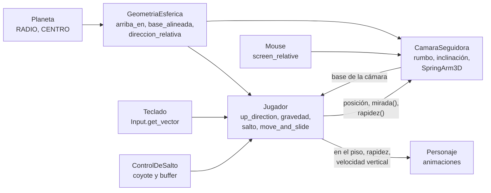
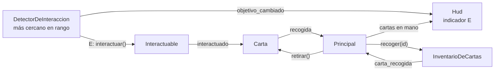
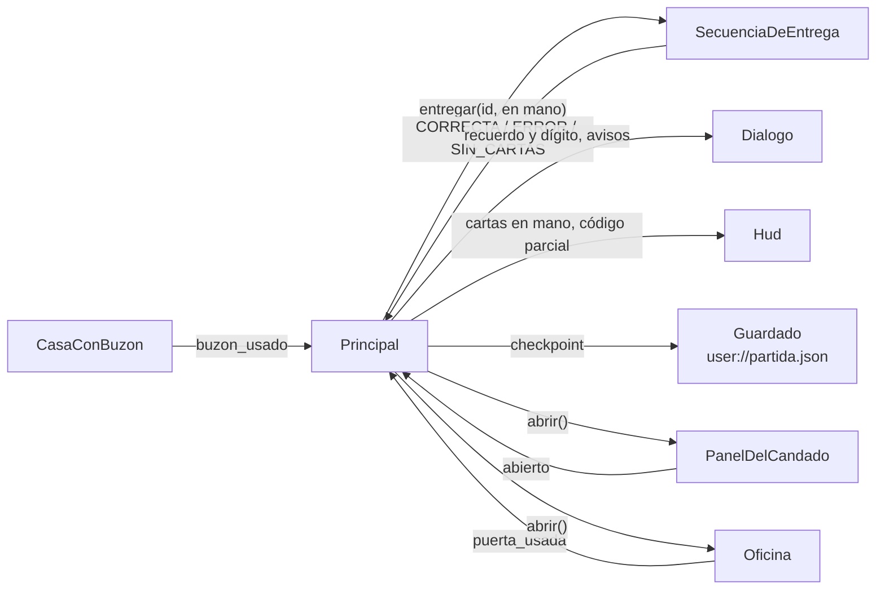

# Planeta Cartero

Juego 3D corto para una sola jugadora, hecho como regalo de cumpleaños. Una
cartera recorre un planeta esférico diminuto, al estilo de los mundos en
miniatura: camina, salta y la gravedad siempre la tira hacia el centro, así
que se puede dar la vuelta entera al planeta en unos segundos. La cámara se
gira con el mouse y una flecha en pantalla señala el próximo objetivo.

- Motor: **Godot 4.7.2** estándar (sin .NET), con GDScript tipado.
- Renderizador: `gl_compatibility` (OpenGL 3.3), para que corra en cualquier
  PC con Windows, incluso con gráficos integrados.
- Entregable: un único `PlanetaCartero.exe` para Windows x86_64 con el `.pck`
  embebido. Corre sin instalar nada y sin conexión a internet: el juego no usa
  red, no recolecta datos y no ejecuta programas externos.

La cartera es una chica animada de Kenney Mini Characters; el resto del mundo
todavía son objetos hechos con primitivas. Una partida va de punta a punta:

1. **Inicio.** Título de cumpleaños, «Continuar» (si hay una partida guardada)
   y «Nueva partida», que muestra un tutorial con los controles.
2. **Zona 1, recolectar.** Cuatro cartas repartidas por el planeta, una sobre
   un techo y otra sobre una plataforma.
3. **Zona 2, entregar en orden.** Cuatro casas con buzón y un cartel con la
   pista del orden. Se puede entregar desde la primera carta. Cada entrega
   correcta muestra un recuerdo y revela un dígito del código del candado; un
   error devuelve las cartas de esa secuencia y vuelve a empezar, sin perder
   los dígitos ya revelados.
4. **Zona 3, oficina de correo.** La puerta se habilita con las cuatro
   entregas y tiene un candado de 4 dígitos. Al abrirlo aparece la carta final
   con el mensaje y la foto.

El progreso se guarda solo al recoger una carta, en cada entrega correcta y al
abrir el candado. Todos los textos, el orden, el código y las imágenes salen
de un archivo de configuración. El juego arranca en pantalla completa y la
interfaz se escala con la ventana a partir de una base de 1920x1080.

## Controles

| Acción | Teclas |
|---|---|
| Mirar alrededor (girar la cámara y subirla o bajarla) | Mouse |
| Moverse | `W` `A` `S` `D` o flechas, relativo a la cámara |
| Saltar | `Espacio` |
| Interactuar con el objeto más cercano (carta, buzón, cartel, puerta) | `E` |
| Pausa con «Continuar» y «Salir», también con un diálogo abierto o en la carta final | `Esc` |
| Elegir en los menús | Flechas o `W` / `S` y `Enter`, o clic |
| Cerrar un diálogo · desplazar su texto | `Enter` o `E` · flechas |
| Candado | Números, `Retroceso` para borrar, `Enter` para probar, `E` para salir |

En la pantalla de inicio, `Esc` cierra el juego. Mientras se juega el cursor
queda oculto y capturado en la ventana; con la pausa, un diálogo, el candado
o la carta final abiertos queda libre, y al cerrarlos se vuelve a capturar.
Si el mouse queda quieto 3 s mientras la cartera camina, la cámara vuelve sola
detrás de ella; con la cartera quieta, la vista queda donde se la dejó.

## Estructura del repo

```
.
├── project.godot            configuración del proyecto: escena inicial, ventana, tema, acciones de teclado
├── export_presets.cfg       preset «Windows Desktop» para exportar el .exe
├── scenes/                  escenas (.tscn) y el tema de la interfaz
│   ├── pantalla_de_inicio.tscn  escena con la que arranca el juego: título y opciones
│   ├── principal.tscn       el juego: entorno, planeta, jugador, cámara, objetos, cartas e interfaz
│   ├── planeta.tscn         esfera con su malla y su colisión
│   ├── jugador.tscn         la cartera (CharacterBody3D) con su colisión, su modelo y su detector de interacción
│   ├── personaje.tscn       el modelo animado de la cartera (se cambia reemplazando su hijo «Modelo»)
│   ├── camara_seguidora.tscn  soporte con SpringArm3D, cámara y luz
│   ├── carta.tscn           carta recolectable con su componente Interactuable
│   ├── casa_con_buzon.tscn  casa de la zona 2 (hereda de casa.tscn) con buzón y rótulo
│   ├── cartel.tscn          cartel con la pista del orden
│   ├── oficina.tscn         oficina de correo con la puerta y la carta final
│   ├── casa.tscn · caja.tscn · plataforma.tscn   objetos de la superficie
│   ├── hud.tscn             cartas en la mano, código parcial, avisos, indicador de la E y flecha de la guía
│   ├── dialogo.tscn · panel_del_candado.tscn · menu_de_pausa.tscn   ventanas de la interfaz
│   └── tema.tres            tema común: tamaño de letra, colores, paneles, botones y guía
├── scripts/                 lógica en GDScript: comportamiento de las escenas y reglas puras
│   └── export.ps1           export local del .exe
├── tests/                   tests headless y su runner
├── data/
│   ├── config.json          contenido del juego con placeholders (versionado)
│   └── config.local.json    contenido real (no se versiona; ver «Contenido personal»)
├── assets/
│   ├── kenney/              modelos 3D de terceros (CC0), un kit por carpeta con su License.txt
│   └── personal/            imágenes propias del juego (fuera de git salvo .gitkeep)
└── .github/workflows/
    └── release.yml          CI: exporta el .exe y crea el Release al pushear un tag
```

`build/` (salida del export) y `.godot/` (caché del editor) se generan y no se
versionan. Tampoco se versionan `data/config.local.json` ni el contenido de
`assets/personal/`: el repo es público y ahí va el contenido personal.

## Taxonomía

| Carpeta | Qué guarda | Convención |
|---|---|---|
| `scenes/` | Una escena por cosa del mundo o ventana de la interfaz, más el tema | `snake_case.tscn`, mismo nombre que su script |
| `scripts/` | Comportamiento de cada escena y reglas sin estado de escena | Archivo en `snake_case.gd`; `class_name` en `PascalCase`; constantes en `MAYUSCULAS` |
| `tests/` | Tests headless; cada uno expone `static func correr(arbol) -> PackedStringArray` con sus fallas | `test_<lo_que_prueba>.gd` |
| `assets/` | Recursos binarios: modelos de terceros y material propio | Una subcarpeta por origen |
| `data/` | Contenido editable del juego en JSON, leído como datos y nunca como código | `config.json` versionado con placeholders, `config.local.json` local |

Los nombres de código están en español. La lógica que tiene que probarse
(los cálculos sobre la esfera, el salto, el config, el inventario, la
elección del objeto con el que se interactúa, la entrega en orden, el
candado, el objetivo de la guía y el guardado) vive en scripts `RefCounted`
que no dependen de escenas, para poder
testearla headless sin abrir el juego. Los tests y la carpeta `docs/` se
excluyen del export.

## Arquitectura

Cada escena es un nodo de Godot con su script; no hay autoloads ni estado
global. Lo que comparten todas es la forma del mundo, que vive en constantes, y
los eventos viajan por señales que conecta la escena principal. La pantalla de
inicio lee el config y el guardado y se los pasa a la escena del juego antes de
agregarla al árbol.

**Reglas sin escenas** (`RefCounted`, con tests headless):

| Pieza | Script | Responsabilidad |
|---|---|---|
| `GeometriaEsferica` | `scripts/geometria_esferica.gd` | Funciones estáticas puras: «arriba» en un punto, bases alineadas a la superficie, giros acotados, dirección de movimiento relativa a la cámara, ángulo de la flecha de la guía en pantalla, ubicación por latitud y longitud, detección de caída fuera del planeta |
| `ControlDeSalto` | `scripts/control_de_salto.gd` | Decide en cada frame si se salta: coyote time y buffer de salto de 0,12 s, sin doble salto |
| `SeleccionDeInteractuable` | `scripts/seleccion_de_interactuable.gd` | Elige la posición más cercana dentro del radio |
| `InventarioDeCartas` | `scripts/inventario_de_cartas.gd` | Ids de las cartas juntadas, sin repetidos; emite `cantidad_cambiada` y `carta_recogida` |
| `SecuenciaDeEntrega` | `scripts/secuencia_de_entrega.gd` | Valida cada entrega contra el orden; cuenta las entregas correctas de la secuencia actual y el máximo de dígitos revelados |
| `GuiaDeObjetivo` | `scripts/guia_de_objetivo.gd` | Elige a qué apunta la guía según la fase; no recibe el orden de entrega, así no lo revela |
| `Candado` | `scripts/candado.gd` | Valida el código de 4 dígitos (como texto, para conservar los ceros), el ingreso dígito a dígito, el dígito de cada recuerdo y el código parcial |
| `EstadoDePartida` | `scripts/estado_de_partida.gd` | Estado de un checkpoint y su validación contra el config cargado |
| `Guardado` | `scripts/guardado.gd` | Escribe, lee y borra el archivo de guardado en `user://` |
| `Configuracion` | `scripts/configuracion.gd` | Elige el config activo, lo lee como datos, devuelve cada valor o su valor por defecto y valida que esté completo |

**Escenas:**

| Pieza | Script | Responsabilidad |
|---|---|---|
| `Planeta` | `scripts/planeta.gd` | `StaticBody3D` en el origen; expone `RADIO` y `CENTRO` como constantes |
| `Jugador` | `scripts/jugador.gd` | `CharacterBody3D`: entrada con aceleración y frenado, gravedad hacia el centro (más fuerte en la bajada), salto, giro suave hacia donde camina y reubicación si se pierde; le cuenta al `Personaje` qué está haciendo |
| `Personaje` | `scripts/personaje.gd` | Modelo animado: `idle`, `walk`, `jump` y `fall` según el estado, y los gestos `pick-up`, `interact-right` y `emote-yes`, que se cortan en cuanto la cartera se mueve |
| `CamaraSeguidora` | `scripts/camara_seguidora.gd` | Sigue al jugador con un `SpringArm3D`; el mouse gira el rumbo y la inclinación (con topes) y, con el mouse quieto y la cartera caminando, vuelve sola detrás de ella |
| `ControlDelCursor` | `scripts/control_del_cursor.gd` | Captura el cursor con el juego en curso y lo libera con el árbol en pausa; avisa el cambio con `juego_en_curso_cambiado` |
| `ObjetoEnSuperficie` | `scripts/objeto_en_superficie.gd` | Apoya un objeto sobre la esfera a partir de latitud, longitud y giro |
| `Interactuable` | `scripts/interactuable.gd` | Componente que se agrega como hijo a cualquier objeto que se usa con `E`; se anota en un grupo y emite `interactuado` |
| `DetectorDeInteraccion` | `scripts/detector_de_interaccion.gd` | Hijo del jugador: elige el interactuable más cercano dentro de un radio, avisa con `objetivo_cambiado` y le pasa la `E` |
| `Carta` | `scripts/carta.gd` | Carta con su `id`; emite `recogida` al usarla y se retira si el inventario la acepta |
| `CasaConBuzon` | `scripts/casa_con_buzon.gd` | Casa con buzón; recibe `id` y rótulo del config por posición, emite `buzon_usado` y se apaga cuando ya recibió su carta |
| `Cartel` | `scripts/cartel.gd` | Emite `leido`; se puede usar siempre |
| `Oficina` | `scripts/oficina.gd` | Emite `puerta_usada` y `carta_final_usada`; `abrir()` saca la puerta y habilita la carta final |
| `Principal` | `scripts/principal.gd` | Arma la partida: conecta objetos, reglas e interfaz, restaura el estado y guarda en cada checkpoint |
| `PantallaDeInicio` | `scripts/pantalla_de_inicio.gd` | Título y opciones; crea la escena del juego con el config y el guardado |
| `Hud` | `scripts/hud.gd` | Cartas en la mano, código parcial desde el primer dígito, avisos breves, indicador de la `E` y la guía, oculta con el juego en pausa |
| `Guia` | `scripts/guia.gd` | Flecha dibujada con los colores del tema; el HUD la gira |
| `Dialogo` | `scripts/dialogo.gd` | Texto desplazable con imagen opcional: tutorial, pista, recuerdos, avisos y carta final |
| `PanelDelCandado` | `scripts/panel_del_candado.gd` | Lee los dígitos del teclado y emite `abierto` con el código correcto |
| `MenuDePausa` · `MenuDeOpciones` | `scripts/menu_de_pausa.gd` · `scripts/menu_de_opciones.gd` | Pausa con «Continuar» y «Salir»; lista de botones que se elige con el teclado o con clic, con la opción marcada siguiendo al foco |

### Ubicación de los objetos

Todo se ubica por latitud y longitud sobre el planeta de radio 10. La partida
empieza en el polo norte, mirando hacia el cartel.

| Objeto | Latitud, longitud | Nota |
|---|---|---|
| Cartel de la pista | 75°, 180° | A unos 2,6 m del punto de partida |
| Casas con buzón (A, B, C, D) | 30°, 0° · 10°, 90° · −20°, 180° · 0°, −90° | Las casas del mundo, en el orden de `entrega.casas`; el buzón va al costado, no frente a la pared por la que se sube al techo |
| Oficina de correo | 0°, 135° | Puerta mirando hacia la casa B, con al menos 5 m libres alrededor |
| Cartas | 70°, 20° · techo de la casa A · plataforma en 50°, −60° · −30°, 150° | Sin cambios desde la zona 1 |

### Flujo de datos en cada frame de física



1. **Jugador.** Calcula `arriba = GeometriaEsferica.arriba_en(posición, Planeta.CENTRO)`
   y lo asigna a `up_direction`, así `is_on_floor()` funciona en cualquier punto
   del planeta. Separa la velocidad en una parte vertical (gravedad hacia el
   centro, 1,6 veces más fuerte al bajar, y salto) y una tangencial (la entrada
   del teclado convertida a una dirección sobre la superficie relativa a la
   cámara, a la que se llega con aceleración y de la que se sale con frenado).
   `ControlDeSalto` decide si salta, con coyote time y buffer. Después gira el
   cuerpo hacia donde camina a 720°/s como mucho, lo alinea con
   `base_alineada(arriba, rumbo)`, llama a `move_and_slide()` y le pasa al
   `Personaje` el estado para elegir la animación.
2. **Rumbo transportado.** La base del personaje se recalcula cada frame desde
   la del frame anterior, sin usar ejes globales. Por eso no hay un punto
   singular en los polos: el «adelante» viaja con el personaje.
3. **CamaraSeguidora.** Lleva su «arriba» al del jugador (como mucho a
   180°/s, por si el jugador se reubica de golpe) y reproyecta su rumbo sobre
   el plano tangente nuevo, que es el mismo transporte del personaje. El mouse
   gira ese rumbo alrededor del «arriba» y cambia la inclinación del brazo
   entre −10° y 65°; lo lee en `_unhandled_input`, que no corre con el árbol en
   pausa, así con el cursor libre la cámara no se mueve. Con el mouse quieto
   3 s y la cartera caminando, el rumbo y la inclinación vuelven a los de por
   defecto a 90°/s; si la cartera camina hacia la cámara (más de 100° del
   rumbo) el rumbo no la persigue, para que `S` no cambie de sentido. La
   posición se acerca con suavizado exponencial, el `SpringArm3D` acorta el
   brazo ante obstáculos y la cámara llega a ese largo de a poco. La luz
   direccional va dentro de este soporte para que la zona donde se juega esté
   siempre iluminada.
4. **Objetos de la superficie.** Al arrancar, cada uno se ubica con
   `transform_en_superficie(CENTRO, RADIO + altura, latitud, longitud, giro)`.

### Flujo de una interacción



1. En cada frame de física el detector toma los nodos del grupo de
   interactuables habilitados y elige el más cercano a su posición dentro del
   radio. Si cambia, lo anuncia y el HUD dibuja la `E` sobre él.
2. La `E` se lee como evento en `_unhandled_input`: el detector llama a
   `interactuar()`, el componente emite `interactuado` y el objeto dueño decide
   qué hacer. Un diálogo abierto consume la `E` antes que el detector, así
   cerrarlo con `E` no vuelve a abrir el mismo objeto.
3. La carta avisa que la recogieron. La escena principal se la pasa al
   inventario y, si la acepta, la retira del planeta; el inventario emite
   `carta_recogida` y la escena guarda el checkpoint.

### Flujo de la entrega y del candado



1. Las cartas en la mano son las juntadas menos las entregadas en la
   secuencia actual. Como las cartas son intercambiables, la secuencia sólo
   cuenta entregas: al reiniciarse tras un error, las entregadas vuelven solas
   a la mano.
2. La entrega correcta número *N* muestra `entrega.recuerdos[N]` y el dígito
   *N* de `oficina.codigo`. Los dígitos revelados guardan el máximo alcanzado,
   así un error no los borra, y el HUD los muestra hasta el final.
3. Con las cuatro entregas, la puerta abre el candado en lugar del aviso. El
   código correcto saca la puerta y habilita la carta final, que no se cierra:
   desde ahí sólo queda la pausa.

### Guía hacia el próximo objetivo

En cada frame de física la escena principal le pasa a `GuiaDeObjetivo` las
posiciones de las cartas que quedan en el planeta, los buzones con sus ids, la
secuencia de entrega, la puerta y la carta final. El objetivo es, por fase: la
carta más cercana mientras queden cartas en el planeta (también después de un
error); si no, el buzón pendiente más cercano, sin distinguir el correcto; con
la zona 2 completa, la puerta; con el candado abierto, la carta final.
`GeometriaEsferica.angulo_en_pantalla` convierte la dirección hacia el
objetivo, medida sobre el plano tangente, en un ángulo respecto del
«adelante» de la cámara, y el HUD gira la flecha con ese ángulo. Un test
comprueba que cambiar `entrega.orden` no cambia el objetivo.

### Pausa, diálogos y guardado

- Los diálogos, el candado y la pausa ponen el árbol en pausa y procesan
  siempre, así leen el teclado mientras el mundo está detenido.
  `ControlDelCursor` mira sólo eso: con el árbol en pausa libera el cursor y
  el HUD oculta la guía; al reanudarse, captura el cursor y la muestra. El menú de
  pausa va último en la escena para recibir `Esc` antes que todos y, al
  cerrarse, deja la pausa como estaba: si había un diálogo abierto, el mundo
  sigue detenido detrás.
- El guardado sólo tiene los ids de las cartas juntadas, la cantidad de
  entregas, la de dígitos revelados y si el candado está abierto: nada de
  textos, rutas ni el código. Un archivo ilegible o incoherente con el config
  cargado se ignora y la partida empieza de cero. Al continuar, la jugadora
  aparece en el punto de partida, que está despejado.
- Cargada sola (como en los tests), la escena del juego no lee ni escribe el
  guardado.
- En los menús, `ui_accept` tiene sólo `Enter` (no `Espacio`), así un salto
  apretado de más no elige una opción.

## Contenido personal

El repo es público, así que versiona sólo `data/config.json`, con textos de
placeholder entre corchetes y el código `"0000"`. El contenido real va en dos
lugares que git ignora:

- `data/config.local.json`: copia de `config.json` con los valores reales. Si
  existe, el juego usa ese archivo entero en lugar de `config.json`; si no es
  JSON válido, avisa en la salida y vuelve a `config.json`.
- `assets/personal/`: las imágenes de los recuerdos y la foto final (PNG, JPG
  o WebP). Las rutas del config tienen que empezar con
  `res://assets/personal/`; una imagen vacía o que no existe se omite y se
  muestra sólo el texto.

`data/config.json` sirve de referencia del formato. Una clave que falta no
rompe el juego: se usa un texto por defecto y se avisa en la salida. Los tests
validan `config.json` y, si existe, también `config.local.json` y que sus
imágenes existan, así un error se ve antes de exportar.

## Cómo se corre

Requiere [Godot 4.7.2](https://godotengine.org/download/archive/4.7.2-stable/)
estándar.

```sh
# Abrir en el editor
godot --editor --path .

# Correr el juego directamente (en ventana, para probar)
godot --path . --windowed
```

## Cómo se testea

Los tests corren sin ventana y terminan con código de salida distinto de 0 si
alguno falla. En un clon recién hecho, primero hay que importar el proyecto
para que Godot registre las clases globales:

```sh
godot --headless --editor --quit      # sólo la primera vez
godot --headless --script res://tests/correr_tests.gd
```

| Test | Qué verifica |
|---|---|
| `test_geometria_esferica.gd` | Los cálculos puros, incluido el paso por los polos y el ángulo de la guía en pantalla |
| `test_planeta.gd` | Que la malla y la colisión del planeta usen el mismo radio y centro que las constantes |
| `test_control_de_salto.gd` | Salto desde el piso, sin doble salto, coyote time y buffer de salto dentro y fuera de su ventana |
| `test_jugador_en_planeta.gd` | Integración con la escena principal: caída y alineación, caminata, paso por el polo sur, aceleración, media vuelta y orientación, salto (altura y bajada más rápida que la subida), reubicación, cámara con mouse (sentido, sensibilidad, topes de inclinación, quieta en pausa, vuelta automática sólo caminando) y velocidad de giro de la cámara (simula unos 30 s de juego) |
| `test_configuracion.gd` | Lectura del config: claves anidadas, valores por defecto ante claves faltantes o inválidas, JSON inválido, tutorial sin alguna de las cinco acciones, prioridad del config local, validación completa de `config.json` (y del local si existe) y que el versionado sólo tenga placeholders y el código `"0000"` |
| `test_seleccion_de_interactuable.gd` | Elección del interactuable: ninguno en rango, el más cercano entre varios, borde del radio y empates |
| `test_inventario_de_cartas.gd` | Inventario: cantidad, cartas repetidas o sin id y las señales que emite |
| `test_cartas_en_escena.gd` | Integración de la zona 1: cuatro cartas con ids del config, indicador y `E` lejos y cerca, recoger y actualizar el HUD, y que la carta del techo no se alcance desde el piso y sí saltando |
| `test_candado.gd` | Código correcto, incorrecto, corto, no numérico y con ceros adelante; ingreso y borrado; dígito de cada recuerdo y código parcial |
| `test_secuencia_de_entrega.gd` | Orden correcto, error en la primera y en la tercera, buzón repetido, entrega con una sola carta, sin cartas, cartas devueltas tras un error y restauración |
| `test_guia_de_objetivo.gd` | Objetivo de la guía en cada fase, nunca un buzón ya entregado, y el mismo objetivo con órdenes de entrega distintos |
| `test_guardado.gd` | Ida y vuelta del estado en cada tipo de checkpoint, contenido del archivo y guardados corruptos, incompletos o incoherentes |
| `test_recorrido_completo.gd` | Integración de la partida entera simulando el teclado: tutorial, pausa (también con el botón «Continuar»), guía oculta con el juego detenido, las 4 cartas, entregas con un error, candado con un error, carta final y «Continuar» desde la pantalla de inicio hasta el final (unos 12 s) |

Cada test también se puede correr por separado con
`godot --headless --script res://tests/<test>.gd`.

## Cómo se exporta

Requiere las plantillas de export de Godot 4.7.2 (Windows x86_64) instaladas.
Desde la raíz del repo, en Windows:

```powershell
powershell -File scripts/export.ps1
```

El script busca Godot en el `PATH` o en `C:\Godot`, importa el proyecto si
falta `.godot/`, exporta con el preset «Windows Desktop» y deja
`build/PlanetaCartero.exe`. Termina con código distinto de 0 si el export
falla o si el ejecutable no aparece.

El preset empaqueta `data/*.json` y `assets/personal/*`, así que el export
local lleva el contenido real si está en la PC. Para generar el ejecutable que
se entrega:

1. Completar `data/config.local.json` y copiar las imágenes a
   `assets/personal/`.
2. Correr los tests: validan el config local y que existan sus imágenes.
3. Correr `scripts/export.ps1`. Si no encuentra `data/config.local.json`,
   avisa que el ejecutable va a salir con placeholders.
4. Copiar `build/PlanetaCartero.exe` a otra carpeta y abrirlo para comprobar
   que muestra el contenido real.

Ese ejecutable no se publica: se entrega en mano. El que publica el CI sale
siempre con los placeholders.

## Cómo se publica

El workflow `.github/workflows/release.yml` se dispara al pushear un tag `v*`:

1. Baja el editor de Linux y las plantillas de Godot 4.7.2 de los releases
   oficiales de `godotengine/godot` y verifica su SHA-512.
2. Importa el proyecto y corre los tests; si alguno falla, no publica.
3. Exporta `PlanetaCartero.exe` con el mismo preset que el export local.
4. Crea un Release con el `.exe` adjunto y las notas del tag. Los tags `v0.x`
   salen como prerelease; desde `v1.0.0`, como release normal.

```sh
git tag -a v0.1.0 -m "..."
git push origin v0.1.0
```

El workflow sólo usa el `GITHUB_TOKEN` que provee GitHub Actions, con permiso
de escritura limitado al job que crea el Release.

## Créditos

| Asset | Autor | Fuente | Licencia | Dónde |
|---|---|---|---|---|
| Mini Characters 1.0 (`character-female-b`, la cartera) | Kenney | [kenney.nl/assets/mini-characters](https://kenney.nl/assets/mini-characters) | CC0 1.0 | `assets/kenney/mini-characters/`, con su `License.txt` |

El resto de los objetos del mundo son, por ahora, primitivas de Godot
(esferas, cápsulas y cajas). Todo asset de terceros que se incorpore figura
acá con su nombre, autor, fuente y licencia.
