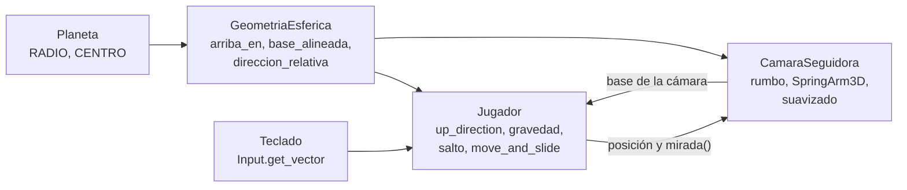

# Planeta Cartero

Juego 3D corto para una sola jugadora, hecho como regalo de cumpleaños. Una
cartera recorre un planeta esférico diminuto, al estilo de los mundos en
miniatura: camina, salta y la gravedad siempre la tira hacia el centro, así
que se puede dar la vuelta entera al planeta en unos segundos.

- Motor: **Godot 4.7.2** estándar (sin .NET), con GDScript tipado.
- Renderizador: `gl_compatibility` (OpenGL 3.3), para que corra en cualquier
  PC con Windows, incluso con gráficos integrados.
- Entregable: un único `PlanetaCartero.exe` para Windows x86_64 con el `.pck`
  embebido. Corre sin instalar nada y sin conexión a internet: el juego no usa
  red, no recolecta datos y no ejecuta programas externos.

Hoy el juego tiene el planeta, el personaje con gravedad esférica, el salto,
la cámara en tercera persona y objetos de prueba (casas, cajas y plataformas)
hechos con primitivas.

## Controles

| Acción | Teclas |
|---|---|
| Moverse | `W` `A` `S` `D` o flechas, relativo a la cámara |
| Saltar | `Espacio` |
| Salir | `Esc` |

## Estructura del repo

```
.
├── project.godot            configuración del proyecto: escena principal, acciones de teclado, renderizador
├── export_presets.cfg       preset «Windows Desktop» para exportar el .exe
├── scenes/                  escenas (.tscn)
│   ├── principal.tscn       escena raíz: entorno, planeta, jugador, cámara y objetos
│   ├── planeta.tscn         esfera con su malla y su colisión
│   ├── jugador.tscn         la cartera (CharacterBody3D)
│   ├── camara_seguidora.tscn  soporte con SpringArm3D, cámara y luz
│   └── casa.tscn · caja.tscn · plataforma.tscn   objetos de la superficie
├── scripts/                 lógica en GDScript: comportamiento de las escenas y cálculos puros
│   └── export.ps1           export local del .exe
├── tests/                   tests headless y su runner
├── assets/
│   ├── kenney/              modelos 3D de terceros (CC0)
│   └── personal/            imágenes propias del juego
└── .github/workflows/
    └── release.yml          CI: exporta el .exe y crea el Release al pushear un tag
```

`build/` (salida del export) y `.godot/` (caché del editor) se generan y no se
versionan.

## Taxonomía

| Carpeta | Qué guarda | Convención |
|---|---|---|
| `scenes/` | Una escena por cosa del mundo, instanciada desde `principal.tscn` | `snake_case.tscn`, mismo nombre que su script |
| `scripts/` | Comportamiento de cada escena y cálculos sin estado | Archivo en `snake_case.gd`; `class_name` en `PascalCase`; constantes en `MAYUSCULAS` |
| `tests/` | Tests headless; cada uno expone `static func correr(arbol) -> PackedStringArray` con sus fallas | `test_<lo_que_prueba>.gd` |
| `assets/` | Recursos binarios: modelos de terceros y material propio | Una subcarpeta por origen |
| `data/` | Contenido editable del juego en JSON, leído como datos y nunca como código | Un único `config.json` |

Los nombres de código están en español. La lógica que tiene que probarse
(los cálculos sobre la esfera, y en adelante la de los puzzles) vive en
scripts que no dependen de escenas, para poder testearla headless sin abrir
el juego. Los tests y la carpeta `docs/` se excluyen del export.

## Arquitectura

Cada escena es un nodo de Godot con su script; no hay autoloads ni estado
global. Lo que comparten todas es la forma del mundo, que vive en constantes:

| Pieza | Script | Responsabilidad |
|---|---|---|
| `GeometriaEsferica` | `scripts/geometria_esferica.gd` | Funciones estáticas puras: «arriba» en un punto, bases alineadas a la superficie, giros acotados, dirección de movimiento relativa a la cámara, ubicación por latitud y longitud, detección de caída fuera del planeta |
| `Planeta` | `scripts/planeta.gd` | `StaticBody3D` en el origen; expone `RADIO` y `CENTRO` como constantes |
| `Jugador` | `scripts/jugador.gd` | `CharacterBody3D`: entrada, gravedad hacia el centro, salto, orientación y reubicación si se pierde |
| `CamaraSeguidora` | `scripts/camara_seguidora.gd` | Sigue al jugador desde atrás y arriba con un `SpringArm3D`, suavizada y sin mouse |
| `ObjetoEnSuperficie` | `scripts/objeto_en_superficie.gd` | Apoya un objeto sobre la esfera a partir de latitud, longitud y giro |

### Flujo de datos en cada frame de física



1. **Jugador.** Calcula `arriba = GeometriaEsferica.arriba_en(posición, Planeta.CENTRO)`
   y lo asigna a `up_direction`, así `is_on_floor()` funciona en cualquier punto
   del planeta. Separa la velocidad en una parte vertical (gravedad hacia el
   centro y salto) y una tangencial (la entrada del teclado convertida a una
   dirección sobre la superficie relativa a la cámara). Después alinea el
   cuerpo con `base_alineada(arriba, rumbo)` y llama a `move_and_slide()`.
2. **Rumbo transportado.** La base del personaje se recalcula cada frame desde
   la del frame anterior, sin usar ejes globales. Por eso no hay un punto
   singular en los polos: el «adelante» viaja con el personaje.
3. **CamaraSeguidora.** Copia el «arriba» del jugador, gira su propio rumbo
   hacia la `mirada()` del jugador con velocidad acotada (como mucho 180°/s) y
   acerca su posición con suavizado exponencial. El `SpringArm3D` acorta el
   brazo ante obstáculos y la cámara llega a ese largo de a poco. La luz
   direccional va dentro de este soporte para que la zona donde se juega esté
   siempre iluminada.
4. **Objetos de la superficie.** Al arrancar, cada uno se ubica con
   `transform_en_superficie(CENTRO, RADIO + altura, latitud, longitud, giro)`.

## Cómo se corre

Requiere [Godot 4.7.2](https://godotengine.org/download/archive/4.7.2-stable/)
estándar.

```sh
# Abrir en el editor
godot --editor --path .

# Correr el juego directamente
godot --path .
```

## Cómo se testea

Los tests corren sin ventana y terminan con código de salida distinto de 0 si
alguno falla. En un clon recién hecho, primero hay que importar el proyecto
para que Godot registre las clases globales:

```sh
godot --headless --editor --quit      # sólo la primera vez
godot --headless --script res://tests/correr_tests.gd
```

| Test | Qué verifica |
|---|---|
| `test_geometria_esferica.gd` | Los cálculos puros, incluido el paso por los polos |
| `test_planeta.gd` | Que la malla y la colisión del planeta usen el mismo radio y centro que las constantes |
| `test_jugador_en_planeta.gd` | Integración con la escena principal: caída y alineación, caminata, paso por el polo sur, salto, reubicación y velocidad de giro de la cámara (simula unos 12 s de juego) |

Cada test también se puede correr por separado con
`godot --headless --script res://tests/<test>.gd`.

## Cómo se exporta

Requiere las plantillas de export de Godot 4.7.2 (Windows x86_64) instaladas.
Desde la raíz del repo, en Windows:

```powershell
powershell -File scripts/export.ps1
```

El script busca Godot en el `PATH` o en `C:\Godot`, importa el proyecto si
falta `.godot/`, exporta con el preset «Windows Desktop» y deja
`build/PlanetaCartero.exe`. Termina con código distinto de 0 si el export
falla o si el ejecutable no aparece.

## Cómo se publica

El workflow `.github/workflows/release.yml` se dispara al pushear un tag `v*`:

1. Baja el editor de Linux y las plantillas de Godot 4.7.2 de los releases
   oficiales de `godotengine/godot` y verifica su SHA-512.
2. Importa el proyecto y corre los tests; si alguno falla, no publica.
3. Exporta `PlanetaCartero.exe` con el mismo preset que el export local.
4. Crea un Release con el `.exe` adjunto y las notas del tag. Los tags `v0.x`
   salen como prerelease; desde `v1.0.0`, como release normal.

```sh
git tag -a v0.1.0 -m "..."
git push origin v0.1.0
```

El workflow sólo usa el `GITHUB_TOKEN` que provee GitHub Actions, con permiso
de escritura limitado al job que crea el Release.

## Créditos

Los objetos del mundo son, por ahora, primitivas de Godot (esferas, cápsulas y
cajas). Todo asset de terceros que se incorpore figura acá con su nombre,
autor, fuente y licencia.
